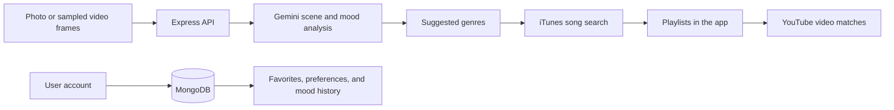

# Synesthesia

**Your surroundings. Your soundtrack.**

Synesthesia is a music discovery application that connects what you see, where you are, and how your moment feels to music. Capture a photo or record a video to discover matching songs, explore music connected to places, or start a listening session shaped by the time of day, local weather, and your music preferences.

The project includes an Expo / React Native frontend for mobile and web, and an Express backend backed by MongoDB.

## Features

| Feature | What it does |
| --- | --- |
| Photo and video discovery | Uses Gemini to describe a scene, infer its mood and energy, and suggest genres. Video analysis uses sampled frames. |
| Recommended playlists | Finds songs through iTunes and groups results into a mood mix and related playlists. |
| Contextual listening | Builds a song queue using time of day, optional local weather, and saved music preferences. |
| Nearby music | Explores regional suggestions, Last.fm charts, and nostalgic music connected to a selected place. |
| Search and playback | Searches songs and opens matching YouTube videos inside the app. |
| Personal library | Saves favorite songs and past mood analyses to an account. |
| Community map and archive | Lets users contribute music history, origins, and personal memories, with moderation before publication. |

AI recommendations are interpretive suggestions. Regional and nostalgia suggestions are distinct from measured listening charts. Playback depends on the availability of embeddable YouTube videos.

## Technology

| Layer | Technologies |
| --- | --- |
| Frontend | Expo SDK 57, React 19, React Native 0.86, TypeScript, Expo Router |
| Backend | Node.js, Express 5 |
| Database | MongoDB, Mongoose |
| Authentication | JWT access tokens, bcrypt password hashing |
| Music and AI | Google Gemini, iTunes Search, YouTube Data API, Last.fm |
| Maps and weather | Native maps / Leaflet, OpenStreetMap, geocoding, Open-Meteo |

## Getting started

### 1. Install the prerequisites

You need:

- **Node.js 22.13 or newer** and npm, matching the [Expo SDK 57 requirements](https://docs.expo.dev/versions/v57.0.0/).
- **MongoDB**, either a running local instance or a MongoDB Atlas cluster.
- A **Gemini API key** for photo/video analysis and AI music suggestions.
- A **YouTube Data API v3 key** for in-app song playback.
- Optionally, a **Last.fm API key** for chart-based discovery.

Use a browser for web development. For mobile development, use an Android emulator, an iOS simulator on macOS, or a physical device with an Expo client compatible with SDK 57. If your Expo Go version does not support the project's SDK or native requirements, use a development build.

### 2. Get the source and install dependencies

Clone or download this repository, then open a terminal at its root. Install the backend and frontend dependencies separately:

```sh
cd backend
npm ci
cd ../frontend
npm ci
cd ..
```

The repository root is not an npm workspace. Run application commands from the relevant folder, as shown below.

### 3. Create the environment files

From the repository root, copy the templates. If you already have `.env` files, keep them and add missing settings instead of overwriting them.

**Windows PowerShell**

```powershell
Copy-Item backend/.env.example backend/.env
Copy-Item frontend/.env.example frontend/.env
```

**macOS / Linux**

```sh
cp backend/.env.example backend/.env
cp frontend/.env.example frontend/.env
```

Edit the new files using the configuration tables below. The example files contain placeholders, so copying them alone is not enough to enable all features.

### 4. Configure the backend

Set the following in `backend/.env`:

| Variable | Purpose | Required / default |
| --- | --- | --- |
| `MONGODB_CONNECTIONSTRING` | MongoDB connection URI | Required to start the backend. Local example: `mongodb://127.0.0.1:27017/synesthesia`. |
| `JWT_ACCESS_SECRET` | Secret used to sign login tokens | Required for authentication. Generate a long random value. |
| `GEMINI_API_KEY` | Gemini scene analysis and AI regional / nostalgia suggestions | Required for those AI features. |
| `YOUTUBE_API_KEY` | YouTube video search for playback | Required for in-app playback. Enable YouTube Data API v3 for the key's Google Cloud project. |
| `LASTFM_API_KEY` | Last.fm country / metro charts | Required for Last.fm charts, including the chart fallback when Gemini is not configured. |
| `PORT` | Backend HTTP port | Optional; defaults to `3000`. |
| `JWT_ACCESS_EXPIRES_IN` | Login token lifetime | Optional; defaults to `30m`. |
| `GEMINI_MODEL` | Gemini model identifier | Optional; defaults to `gemini-3.5-flash-lite`. Use a model available to your API project that supports image input and structured responses. |

Generate a JWT secret with this command, then paste its output into `JWT_ACCESS_SECRET`:

```sh
node -e "console.log(require('node:crypto').randomBytes(48).toString('hex'))"
```

For local MongoDB, start the database service before starting the backend. For MongoDB Atlas, create a database user, allow your development machine's network access, and use the cluster connection URI with your credentials.

Provider setup: [Google AI Studio](https://aistudio.google.com/), [Google Cloud Console](https://console.cloud.google.com/), [Last.fm API](https://www.last.fm/api/account/create), [MongoDB Atlas](https://www.mongodb.com/atlas).

### 5. Configure the frontend address

Set `EXPO_PUBLIC_BACKEND_URL` in `frontend/.env` to an address reachable from the device running the app. Do not add a trailing slash.

| Running the frontend on | Example backend URL |
| --- | --- |
| Web browser on your development computer | `http://localhost:3000` |
| iOS simulator on the backend's Mac | `http://localhost:3000` |
| Android Studio emulator | `http://10.0.2.2:3000` |
| Physical phone on the same local network | `http://192.168.1.100:3000` — replace the example IP with your computer's LAN IP |
| Hosted application | Your deployed backend's HTTPS URL |

For example:

```dotenv
EXPO_PUBLIC_BACKEND_URL=http://localhost:3000
```

For a physical phone, connect the phone and computer to the same network and allow inbound access to the backend port in your firewall. On Windows, `ipconfig` shows the computer's local IPv4 address. Update the URL if you change `PORT`.

`EXPO_PUBLIC_` variables are included in the frontend bundle. Store API keys, database credentials, and the JWT secret only in `backend/.env`.

### 6. Start the backend

Open a terminal at the repository root:

```sh
cd backend
node server.js
```

After MongoDB connects, the server listens on port `3000` by default. Open [http://localhost:3000](http://localhost:3000) to check that the backend responds. Its response confirms server startup; it does not validate external API keys.

### 7. Start the frontend

Keep the backend terminal running. Open a second terminal at the repository root:

```sh
cd frontend
npm start
```

Use the Expo terminal controls to choose a device, or run one of these commands **instead of** `npm start`:

| Target | Command from `frontend/` |
| --- | --- |
| Web browser | `npm run web` |
| Android emulator | `npm run android` |
| iOS simulator on macOS | `npm run ios` |

A physical device can connect through the QR code when using a compatible Expo client. Use a physical device to verify camera, microphone, video recording, location, and media-library permissions. Native features can differ from their browser equivalents.

After changing environment values, restart the backend or Expo server as appropriate. To clear Expo's cache, run `npm start -- --clear` from `frontend/`.

### 8. Try the application

1. Create an account and sign in. Usernames accept 3–30 letters, numbers, or underscores; passwords require at least 8 characters.
2. Open **Capture**, allow camera access, take a photo, and select **Use Photo**.
3. Review the scene, mood, energy, suggested genres, and matching playlists.
4. Open a song to try YouTube playback, or save it with the heart button.
5. Try **Listen** for a contextual queue or **Nearby** for location-based discovery.

Video capture requires microphone permission as well as camera permission. Record a clip, stop recording, and choose **Analyze Video**. Saving the recording to Photos is a separate action.

The community archive starts empty until entries are submitted and published by a moderator. To grant an existing account moderator access, run this command from `backend/` as the trusted database operator:

```sh
node scripts/set-moderator.js EXISTING_USERNAME
```

## How discovery works



Photo data and sampled video frames are sent to the backend and Gemini when you request analysis. The full recorded video is not uploaded for analysis. Account data, favorites, mood history, and community entries use MongoDB. Weather matching sends rounded coordinates from the backend to Open-Meteo; location and geocoding services also receive data needed for the selected map features.

YouTube provides the embedded video player. Playback stops when the listening screen loses focus or the app enters the background; the app does not provide background audio playback or video downloading.

## Project structure

```text
.
├── backend/
│   ├── config/                 # Database setup
│   ├── middleware/             # Authentication and request guards
│   ├── models/                 # MongoDB schemas
│   ├── routes/                 # REST API routes
│   ├── scripts/                # Administrative utilities
│   ├── services/               # Recommendations and provider integrations
│   ├── tests/                  # Backend tests
│   ├── .env.example            # Backend configuration template
│   └── server.js               # API entry point
├── frontend/
│   ├── assets/                 # Images and app assets
│   ├── src/
│   │   ├── app/                # Expo Router screens
│   │   ├── components/capture/ # Capture components and separate style files
│   │   ├── context/            # Authentication state
│   │   ├── hooks/              # Capture state and behavior
│   │   └── services/           # Frontend API helpers
│   ├── .env.example            # Public backend URL template
│   └── app.json                # Expo app configuration
└── README.md
```

`frontend/src/app/index.tsx` selects the current capture view. The `useCaptureScreen` hook manages capture actions and data requests. Capture components have matching `.styles.ts` modules, with shared styles, colors, and data types alongside them. React Native `StyleSheet` modules keep styling compatible across mobile and web.

## Development checks

Run backend tests from `backend/`:

```sh
npm test
```

Run frontend checks from `frontend/`:

```sh
npm run lint
npx tsc --noEmit
```

Backend route tests use mocked database calls where applicable. Automated checks do not replace testing with MongoDB, real provider credentials, and a physical device.

## Troubleshooting

| Problem | What to check |
| --- | --- |
| Backend exits before it starts listening | Confirm that MongoDB is running, the connection URI is valid, and Atlas network access allows your machine. |
| Sign-in or signup fails | Confirm `JWT_ACCESS_SECRET` is set and MongoDB is connected. Check the backend terminal for details. |
| Phone shows a network error | Use the computer's LAN IP rather than `localhost`; check Wi-Fi, the firewall, and the backend port. An Expo tunnel does not expose the backend automatically. |
| Photo/video analysis fails | Check `GEMINI_API_KEY`, model availability, provider quota, and the backend error output. |
| YouTube search or playback fails | Enable YouTube Data API v3, check the key and quota, and try another match. Some videos block embedding or regional playback. |
| Nearby charts are unavailable | Configure `LASTFM_API_KEY` for chart data, or `GEMINI_API_KEY` for AI regional suggestions. Allow location access or select a place manually. |
| Camera or location is unavailable | Check device/browser permissions. Browser access generally requires localhost or HTTPS; test native recording on a device. |
| Environment changes are not reflected | Restart the relevant server; use `npm start -- --clear` for Expo if necessary. |
| Expo reports an SDK mismatch | Use a client compatible with SDK 57 or create a development build. |

## Contributing

Keep changes focused and run the relevant development checks before opening a pull request. Include a description of the behavior changed and how you verified it. For interface changes, include screenshots or a short recording when practical.

Commit source files, lockfiles, and the `.env.example` templates. Git ignore rules exclude local environment files, dependencies, build output, logs, and signing keys. Review staged files before pushing; ignore rules do not remove secrets already tracked by Git.
